<div align="center">
  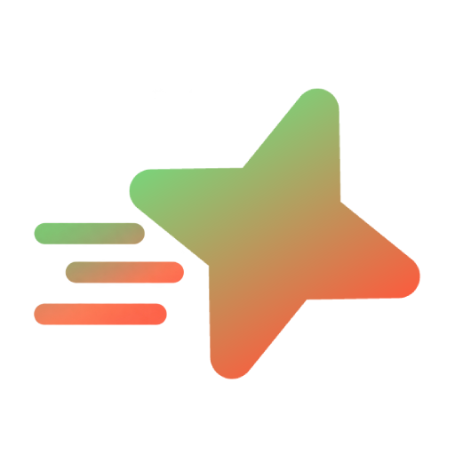
  <p>Lightweight, higher-performance version of BestClient.</p>

  <p>
    <a href="https://bestclient.fun"></a>
    <a href="https://t.me/bestddnet"></a>
    <a href="https://discord.gg/bestclient"></a>
  </p>
</div>

## About

BestClient Light is the lightweight BestClient. It is built to stay close to vanilla DDNet performance on the same machine, and it keeps its own tools on top of that smaller base.

Heavy systems from the full client are not part of this build. What remains is optional: a feature that is turned off does not keep its work on the frame.

## Links

- Website: [bestclient.fun](https://bestclient.fun)
- Telegram: [t.me/bestddnet](https://t.me/bestddnet)
- Discord: [discord.gg/bestclient](https://discord.gg/bestclient)
- Original client: [BestProjectTeam/BestClient](https://github.com/BestProjectTeam/BestClient)

## Settings (version 5.0)

### Visuals

<p align="center">
  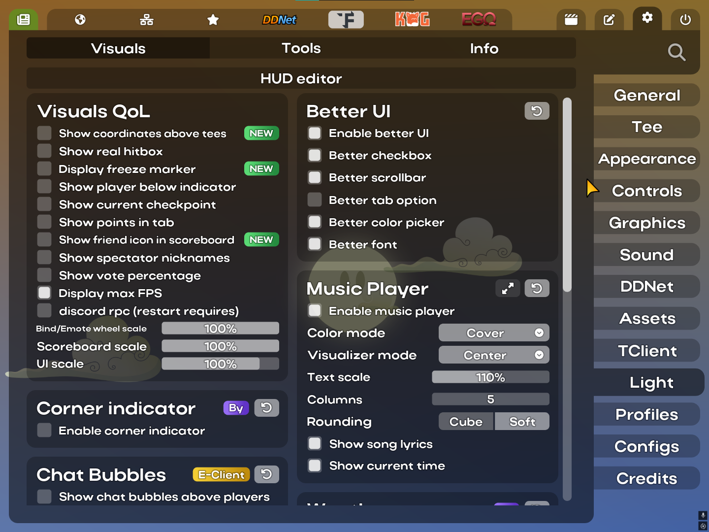
  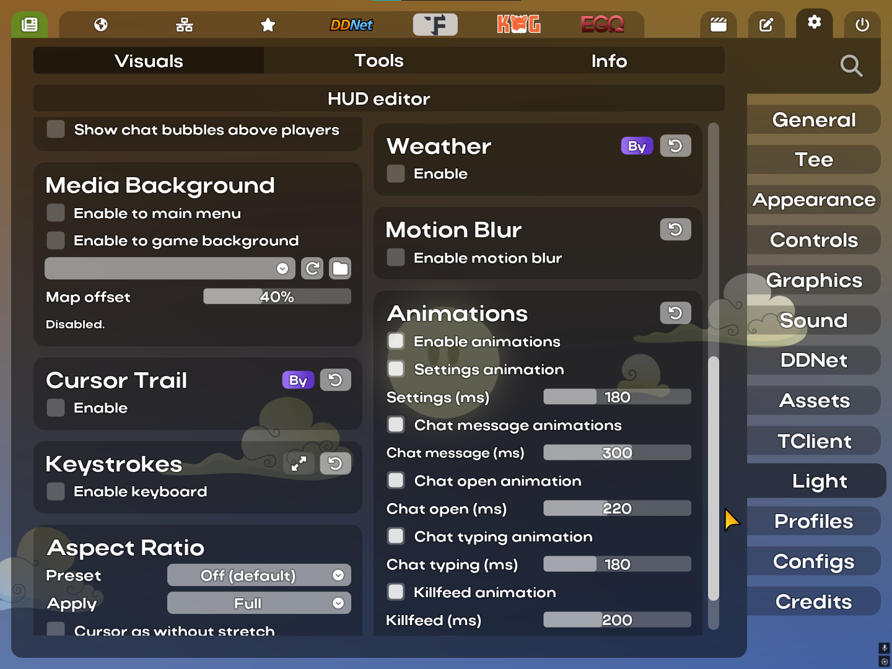
</p>

### Tools

<p align="center">
  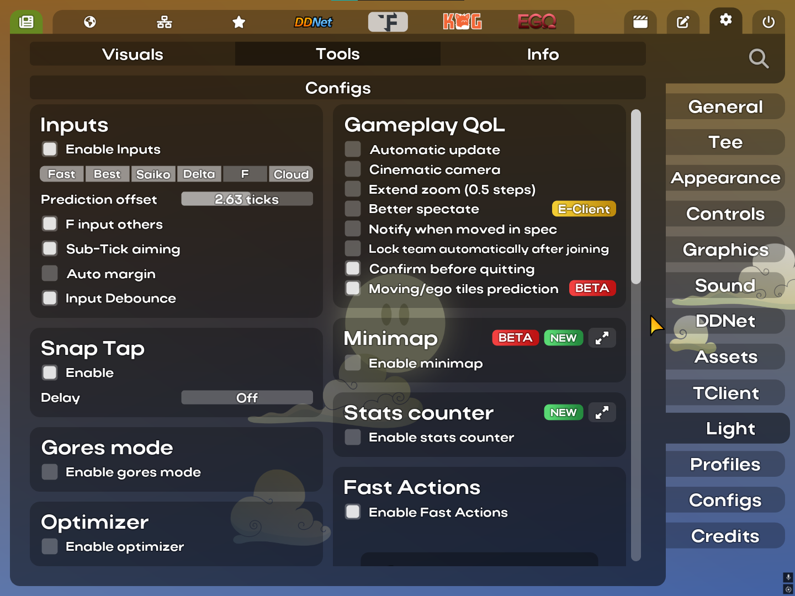
  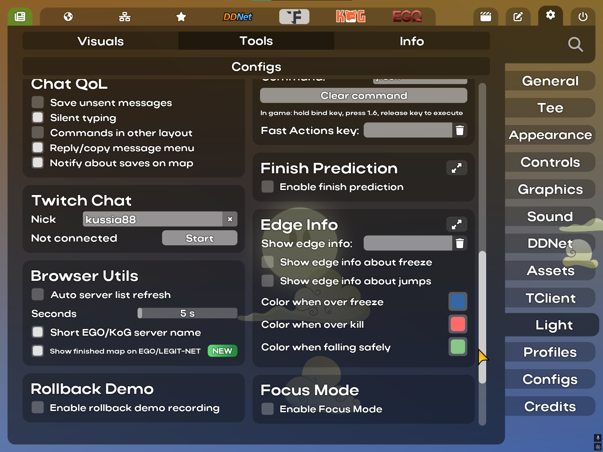
</p>

## Highlight: Minimap

The minimap is the main feature that belongs to BestClient Light.

<p align="center">
  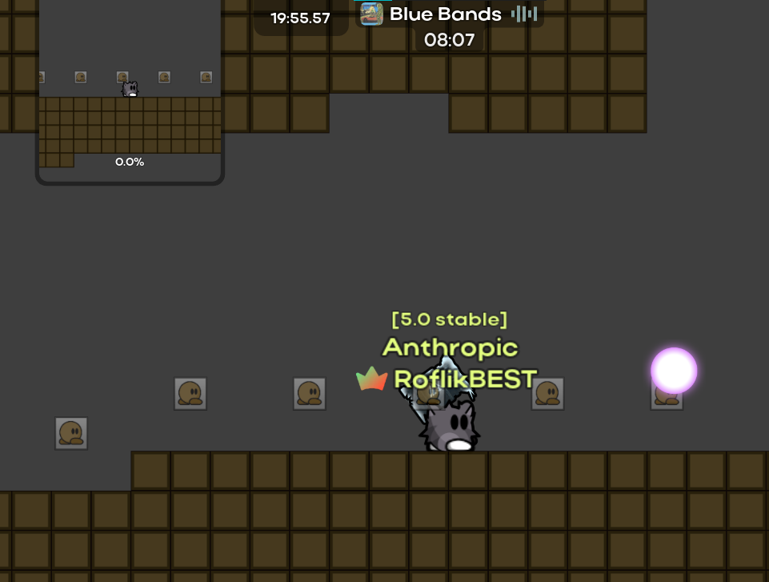
  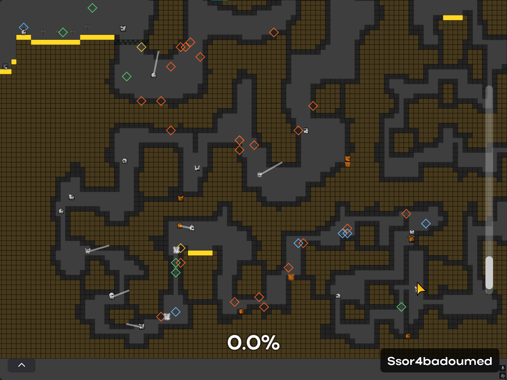
</p>
<p align="center">
  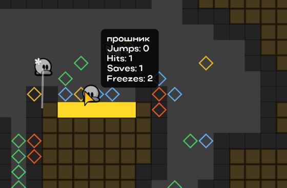
  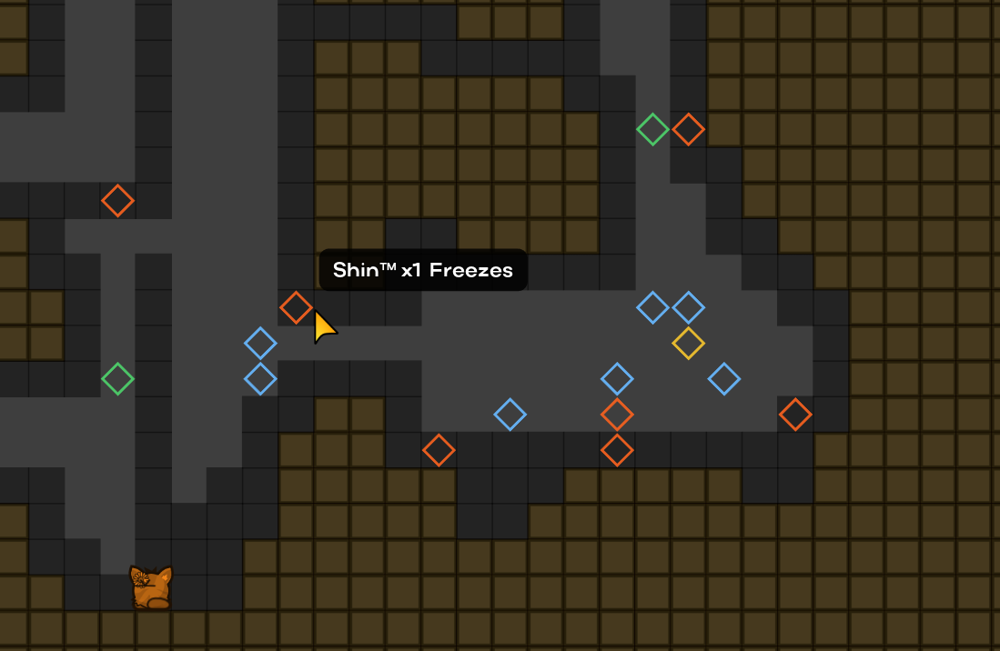
</p>

- Small HUD map, draggable in the HUD editor, with zoom, alpha, tee size, and route progress
- **Map peek** (`+bcl_large_minimap`) and **full map** (`+bcl_large_minimap_full`), both hold binds
- Full map: zoom rail, players, hooks, optional other teams, and a click that follows a tee
- Hover a tee for jumps, hits, saves, and freezes
- Diamond markers for double jumps, hammer hits, saves, and freeze touches. Right-click deletes one marker. **Clear marks** clears the set
- Optional world markers and a route-platform highlight

## Other highlights

<table>
<tr>
<td width="50%" valign="top" align="left">
<strong>Touch controls</strong><br><br>
<p align="center">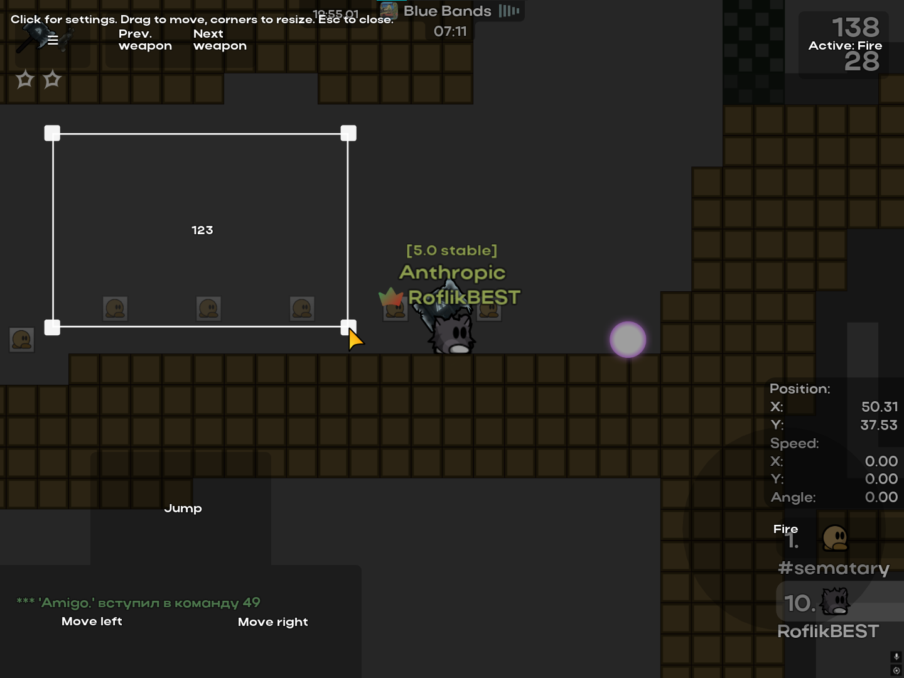</p>
<ul>
<li>In-game <strong>Move buttons</strong> overlay, next to the stock touch editor</li>
<li>Drag a button to move it. Drag a corner to resize it</li>
<li>Release saves the layout to <code>touch_controls.json</code>.</li>
</ul>
</td>
<td width="50%" valign="top" align="left">
<strong>Stats counter</strong><br><br>
<p align="center">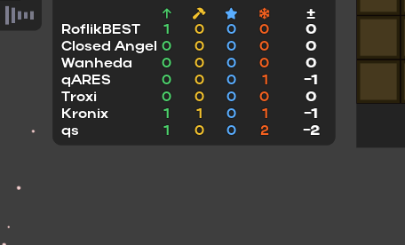</p>
<ul>
<li>HUD table of jumps, hammer hits, saves, and freezes</li>
<li>Score on the right is saves &times; 2 minus freezes</li>
<li>Own module in the HUD editor.</li>
</ul>
</td>
</tr>
</table>

## Feature overview

### Visuals

- **Visuals QoL** — tee coordinates, real hitbox, freeze marker, player-below indicator, checkpoint, scoreboard points and friend mark, spectator names, vote percentage, max FPS, UI / scoreboard / wheel scale
- **Better UI** — checkbox, scrollbar, settings tabs, color picker, and font
- **Music Player** — HUD player with cover or static color, visualizer, lyrics, and current time
- **Corner indicator** — off-screen teammates, with size, distance, and color options
- **Chat Bubbles** — bubbles above players (from Entity-Client)
- **Media Background** — image or video behind the menu and the game background
- **Cursor Trail** — the cursor, or a custom image
- **Keystrokes** — keyboard HUD, full layout or A/D only
- **Aspect Ratio** — presets or a custom ratio, including a cursor that ignores the stretch
- **Weather** — snow, rain, fireflies, or dust
- **Motion Blur** — previous-frame blend
- **Animations** — settings, chat, killfeed, and main-menu motion
- **HUD editor** — drag and resize HUD modules, including the minimap and the stats counter

### Tools

- **Inputs** — Fast, Best, Saiko, Delta, F, and Cloud, plus auto margin
- **Snap Tap** — opposite left/right switching, with an optional delay
- **Gores mode** — entity-like mode, with auto-disable while holding a weapon
- **Optimizer** — particles, quads, high-detail layers, and FPS fog
- **Performance** — high client priority and normal Discord priority (Windows)
- **Gameplay QoL** — auto update, cinematic camera, half-step zoom, better spectate, spec-moved notify, auto team lock, confirm quit, moving/ego tiles prediction
- **Minimap** — HUD map, map peek, and full map. See the highlight above
- **Stats counter** — jump, hit, save, and freeze table. See the highlight above
- **Fast Actions** — quick command selector
- **Chat QoL** — unsent drafts, silent typing, commands on the Russian layout, reply/copy menu, save notice
- **Twitch Chat** — channel nick and a start button
- **Browser Utils** — auto refresh, short EGO/KoG names, finished maps on EGO and Legit Network
- **Rollback Demo** — local demo recording you can roll back
- **Finish Prediction** — remaining time and progress on race maps
- **Edge Info** — freeze, kill, and safe colors at the screen edge (from RushieClient)
- **Focus Mode** — hide names, effects, HUD, chat, scoreboard, and the music player
- **Client Indicator** — BestClient Light mark on nameplates and the scoreboard, plus a browser filter
- **Configs** — save, load, and transfer presets, including a one-time copy from `settings_BestClient.cfg`


### Outside the Light tabs

- **Touch controls** — move and resize overlay described above
- **Translate** — incoming and outgoing chat translation from the chat UI
- **Admin Panel** — say, broadcast, mute, ban, kick, respawn, pause
- **Fast Practice** — local practice with a dummy ghost and practice chat commands

## Build

Initialize submodules first:

```bash
git submodule update --init --recursive
```

Windows debug client:

```bat
scripts\build_client_debug.bat <project-root>
```

The binary is `<project-root>\build\DDNet.exe`.

Quick build:

```bash
cmake -S . -B build -G Ninja -DCMAKE_BUILD_TYPE=Debug -DDEV=ON -DVULKAN=ON
cmake --build build --target everything
```

CI-like build:

```bash
cmake -S . -B build -G Ninja -DCMAKE_BUILD_TYPE=Debug -DDOWNLOAD_GTEST=ON -DDEV=ON
cmake --build build --target everything
```

Run tests:

```bash
cmake --build build --target run_tests
```

Headless test build:

```bash
cmake -S . -B headless -G Ninja -DHEADLESS_CLIENT=ON -DCMAKE_BUILD_TYPE=Debug -DDOWNLOAD_GTEST=ON -DDEV=ON
cmake --build headless --target run_tests
```

## Full config list

Source: `src/engine/shared/config_variables_bestclient-light.h` (280 variables).

<details>
<summary>Expand full list</summary>

```cfg
bcl_frozen_skin
bcl_frozen_skin_darken
bcl_bestclient_light_settings_tabs
bcl_silent_typing
bcl_chat_alt_command_layout
bcl_chat_message_actions
bcl_notify_saves_on_map
bcl_chat_only_tags_and_whispers
bcl_translate_incoming_source
bcl_translate_incoming_ignore_languages
bcl_translate_outgoing_source
bcl_translate_outgoing_target
bcl_translate_outgoing_strip_punctuation
bcl_translate_shift_click_target
bcl_translate_message_button
bcl_auto_update
bcl_twitch_chat_nick
bcl_custom_aspect_ratio_mode
bcl_custom_aspect_ratio_apply_mode
bcl_custom_aspect_ratio
bcl_custom_aspect_ratio_num
bcl_custom_aspect_ratio_den
bcl_custom_aspect_ratio_cursor_native
bcl_show_tee_coords
bcl_show_real_hitbox
bcl_show_real_hitbox_color
bcl_display_freeze_marker
bcl_showhud_dummy_coord_indicator
bcl_show_correct_checkpoint
bcl_show_points_in_tab
bcl_scoreboard_friendmark
bcl_show_spectator_names
bcl_show_vote_percentage
bcl_display_max_fps
bcl_scoreboard_scale
bcl_wheel_scale
ui_scale
bcl_discord_rpc
bcl_cursor_trail
bcl_cursor_trail_mode
bcl_cursor_trail_trail_image
bcl_cursor_trail_trail_size
bcl_cursor_trail_number_of_frames
bcl_cursor_trail_opacity
bcl_cursor_trail_sampling_fps
bcl_cursor_trail_disable_movement
tc_ego_tiles_antilag
bcl_confirm_quit
bcl_cinematic_camera
bcl_cinematic_camera_strength
bcl_spec_moved_notify
bcl_spec_moved_notify_text
bcl_auto_team_lock
bcl_auto_team_lock_delay
bcl_extend_zoom
bcl_better_spectate
bcl_spec_pause_show_delay
bcl_prev_mouse_max_distance_45_degrees
bcl_prev_inp_mousesens_45_degrees
bcl_toggle_45_degrees
bcl_prev_inp_mousesens_small_sens
bcl_toggle_small_sens
bcl_inputs
bcl_best_input_amount
bcl_best_input_smoothing
bcl_best_input_latency_comp
bcl_best_input_interpolation
bcl_best_input_others
bcl_saiko_input_amount
bcl_saiko_input_others
bcl_delta_input_amount
bcl_delta_input_others
bcl_f_input_amount
bcl_f_input_others
bcl_cloud_input_amount
bcl_cloud_input_others
bcl_auto_margin
bcl_mute_others_hook
bcl_mute_others_hammer
bcl_mute_others_airjump
bcl_gores_mode
bcl_gores_mode_disable_weapons
bcl_fast_actions
bcl_snap_tap
bcl_snap_tap_delay
cl_asset_cursor
cl_asset_arrow
snd_pack
bcl_profile_assets
bcl_better_preview
bcl_menu_media_background
bcl_game_media_background
bcl_menu_media_background_path
bcl_game_media_background_offset
bcl_menu_ui_style
bcl_menu_ui_new_checkbox
bcl_menu_ui_new_scrollbar
bcl_menu_ui_new_tab_option
bcl_menu_ui_tab_side
bcl_menu_ui_new_color_picker
bcl_menu_ui_better_font
bcl_show_style_picker
bcl_settings_nav_expanded
bcl_show_settings_transfer
bcl_auto_server_list_refresh
bcl_auto_server_list_refresh_seconds
bcl_use_short_kog_server_name
bcl_show_finished_map_on_ego_legit
br_filter_bestclient_light
bcl_client_indicator_versions
dbg_client_indicator
bcl_nameplate_client_indicator_offset_x
bcl_nameplate_client_indicator_offset_y
bcl_client_indicator_in_name_plate
bcl_client_indicator_in_name_plate_above_self
bcl_client_indicator_in_name_plate_size
bcl_client_indicator_in_name_plate_dynamic
indicator_version
bcl_client_indicator_in_scoreboard
bcl_client_indicator_in_scoreboard_size
bcl_client_indicator_server_address
bcl_client_indicator_browser_url
bcl_client_indicator_token_url
bcl_client_indicator_shared_token
bcl_client_indicator_secret_key
bcl_optimizer
bcl_optimizer_disable_particles
bcl_optimizer_disable_quads
bcl_optimizer_disable_high_detail
bcl_optimizer_fps_fog
bcl_optimizer_fps_fog_mode
bcl_optimizer_fps_fog_radius_tiles
bcl_optimizer_fps_fog_zoom_percent
bcl_optimizer_fps_fog_render_rect
bcl_optimizer_fps_fog_cull_map_tiles
bcl_high_process_priority
bcl_discord_normal_process_priority
bcl_chat_bubbles
bcl_chat_bubbles_self
bcl_chat_bubbles_demo
bcl_chat_bubble_size
bcl_chat_bubble_showtime
bcl_chat_bubble_fadeout
bcl_chat_bubble_fadein
bcl_chat_bubble_animation
bcl_chat_bubble_custom_colors
bcl_chat_bubble_bg_color
bcl_chat_bubble_text_color
bcl_chat_bubble_outline_color
bcl_chat_bubble_rounding
bcl_animations
bcl_module_ui_reveal_animation
bcl_module_ui_reveal_animation_ms
bcl_chat_animation
bcl_chat_animation_ms
bcl_chat_open_animation
bcl_chat_open_animation_ms
bcl_chat_typing_animation
bcl_chat_typing_animation_ms
bcl_killfeed_animation
bcl_killfeed_animation_ms
bcl_main_menu_animation
bcl_main_menu_animation_speed
bcl_chat_animation_type
bcl_motion_blur
bcl_motion_blur_strength
ri_edge_info_color_freeze
ri_edge_info_color_kill
ri_edge_info_color_safe
ri_edge_info_cords
ri_edge_info_jump
ri_edge_info_pos_x
ri_edge_info_pos_y
bcl_hud_music_player_x
bcl_hud_music_player_y
bcl_hud_music_player_scale
bcl_hud_music_player_layout_migrated
bcl_hud_chat_x
bcl_hud_chat_y
bcl_hud_chat_scale
bcl_hud_votes_x
bcl_hud_votes_y
bcl_hud_votes_scale
bcl_keystrokes_keyboard
bcl_keystrokes_mc_layout
bcl_keystrokes_mc_show_lmb
bcl_keystrokes_mc_show_rmb
bcl_keystrokes_mc_show_space
bcl_keystrokes_mc_pressed_opacity
bcl_finish_prediction
bcl_finish_prediction_show_always
bcl_finish_prediction_time_mode
bcl_finish_prediction_show_time
bcl_finish_prediction_show_percentage
bcl_finish_prediction_show_millis
bcl_finish_prediction_consider_freeze_walls
bcl_music_player
bcl_music_player_visualizer_mode
bcl_music_player_visualizer_rounding
bcl_music_player_visualizer_columns
bcl_music_player_color_mode
bcl_music_player_static_color
bcl_music_player_text_scale
bcl_music_player_show_lyrics
bcl_music_player_show_current_time
p_focus_mode
p_focus_mode_hide_names
p_focus_mode_hide_effects
p_focus_mode_hide_hud
p_focus_mode_hide_song_player
p_focus_mode_hide_ui
p_focus_mode_hide_chat
p_focus_mode_hide_scoreboard
p_focus_mode_auto_reply
p_focus_mode_auto_reply_message
bcl_corner_indicator
bcl_corner_indicator_only_in_team
bcl_corner_indicator_show_alive
bcl_corner_indicator_show_frozen
bcl_corner_indicator_indicate_last_teammate
bcl_corner_indicator_proximity
bcl_corner_indicator_proximity_range
bcl_corner_indicator_proximity_min_size
bcl_corner_indicator_ninja_frozen
bcl_corner_indicator_size_alive
bcl_corner_indicator_size_frozen
bcl_corner_indicator_last_teammate_size
bcl_corner_indicator_custom_colors
bcl_corner_indicator_color_alive
bcl_corner_indicator_color_frozen
bcl_corner_indicator_last_teammate_color
bcl_atmosphere
bcl_weather
bcl_weather_amount
bcl_weather_snow_size
bcl_weather_snow_speed
bcl_weather_snow_color
bcl_weather_snowflakes
bcl_weather_rain_size
bcl_weather_rain_speed
bcl_weather_rain_tilt
bcl_weather_rain_color
bcl_weather_firefly_size
bcl_weather_firefly_speed
bcl_weather_firefly_color
bcl_ambient_dust
bcl_ambient_dust_color
bcl_ambient_dust_amount
bcl_weather_dust_size
bcl_weather_dust_speed
bcl_keybind_map_format
bcl_minimap
bcl_minimap_hud
bcl_minimap_zoom
bcl_minimap_sync_zoom
bcl_minimap_alpha
bcl_minimap_players
bcl_minimap_show_others
bcl_minimap_tee_size
bcl_minimap_tee_size_flexible
bcl_minimap_show_alive
bcl_minimap_show_frozen
bcl_minimap_show_critical
bcl_minimap_platforms
bcl_minimap_show_jumps
bcl_minimap_show_hits
bcl_minimap_show_saves
bcl_minimap_show_freezes
bcl_minimap_marks_in_game
bcl_large_minimap_zoom
bcl_large_minimap_current_zoom
bcl_large_minimap_alpha
bcl_large_minimap_progress
bcl_activity_hud
bcl_activity_hud_show_jumps
bcl_activity_hud_show_hits
bcl_activity_hud_show_saves
bcl_activity_hud_show_freezes
bcl_activity_hud_team0
```

</details>

Plain-text export: [docs/bcl_config_list.txt](docs/bcl_config_list.txt).

## Credits / borrowed features

Some BestClient Light features were adapted from other DDNet client forks:

- **Entity-Client** ([FoxNet-DDNet/Entity-Client-DDNet](https://github.com/FoxNet-DDNet/Entity-Client-DDNet)) — Better Spectate (`+specpause`), Chat Bubbles
- **RushieClient** ([RushieClient/RushieClient-ddnet](https://github.com/RushieClient/RushieClient-ddnet)) — Edge Info

## License

BestClient Light code is released under the **[MIT License](LICENSE)**.

Upstream DDNet/Teeworlds code, third-party libraries, and assets under `data/` remain under their original licenses — see [license.txt](license.txt) and per-directory `license.txt` files.
